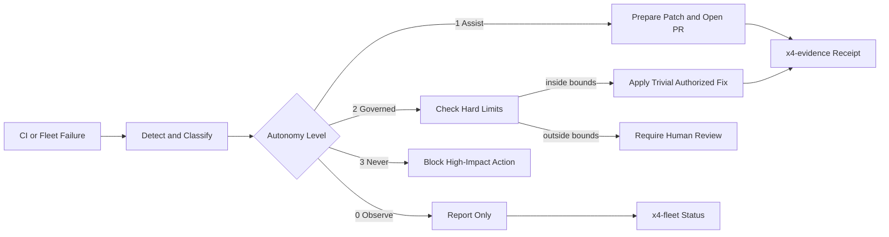
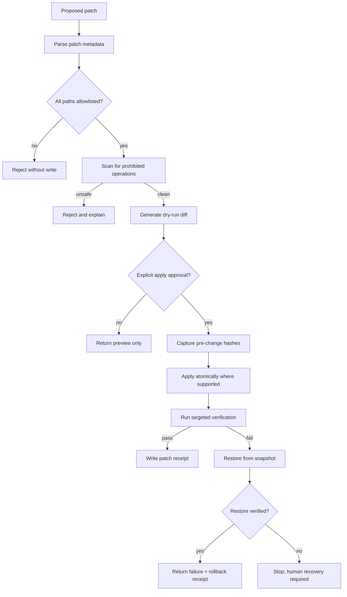

# x4-autofix

**Policy-gated autofix and recovery loops for agent fleets.**

Detect failures, propose repairs, and (when authorized by Level 0–3 policy) apply them. Integrates with x4-fleet and x4-evidence.

<!-- X4-APEX-DIAGRAM-START:x4-autofix -->



<!-- X4-APEX-DIAGRAM-END:x4-autofix -->

## Autonomy Levels

| Level | Name | Allowed |
|-------|------|---------|
| 0 | Observe | Detect + report only |
| 1 | Assist | Open PR with proposed fix |
| 2 | Governed Autopilot | Apply trivial fixes (lint, pin, bump) inside hard limits |
| 3 | Never | Secrets, deletes, force-push, financial |

## Quick Start

```bash
pip install -e ".[dev]"
python -m x4_autofix.detect --repo dhe-cruzer69/x4-beast
```

## License

Apache-2.0

## APEX Architecture Map

> Status: architecture documentation; implementation and deployment claims require independent verification.


**Evidence note:** Atomicity and rollback are filesystem-dependent. Verify backups, path handling, and failure-injection tests before enabling write mode.

